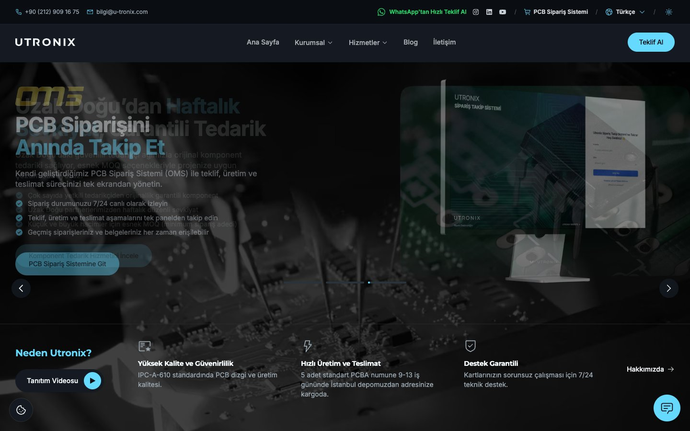
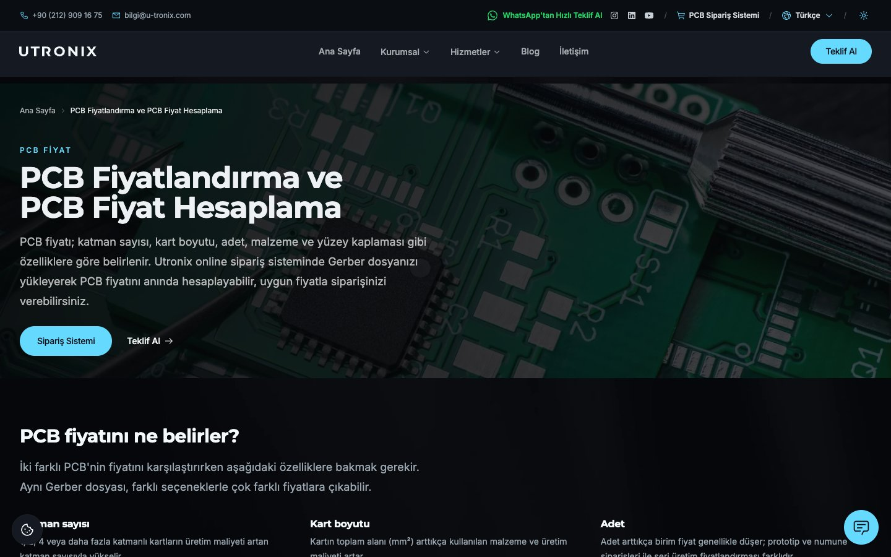
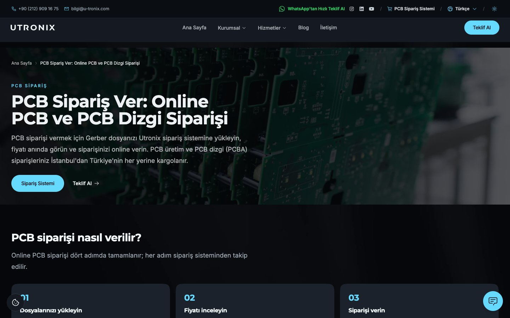
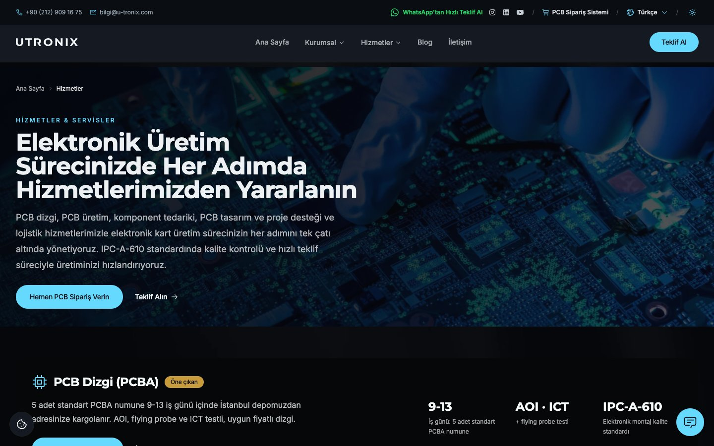
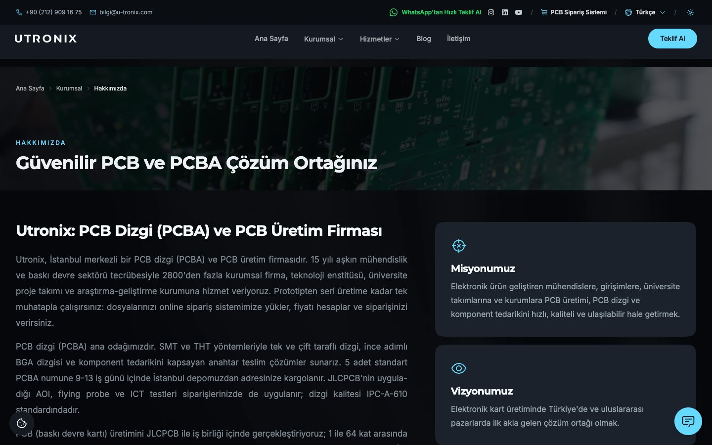
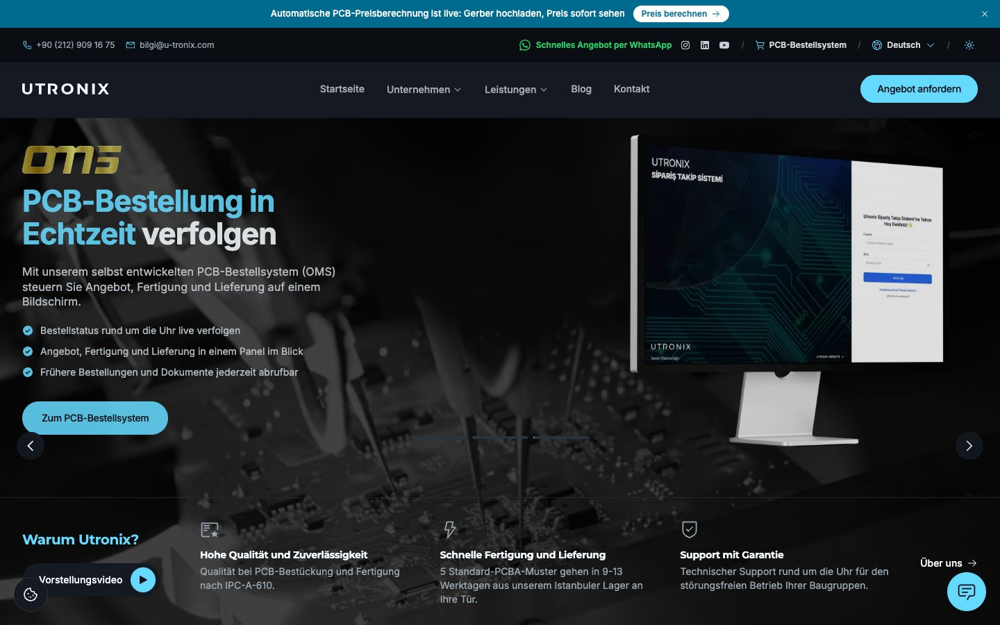
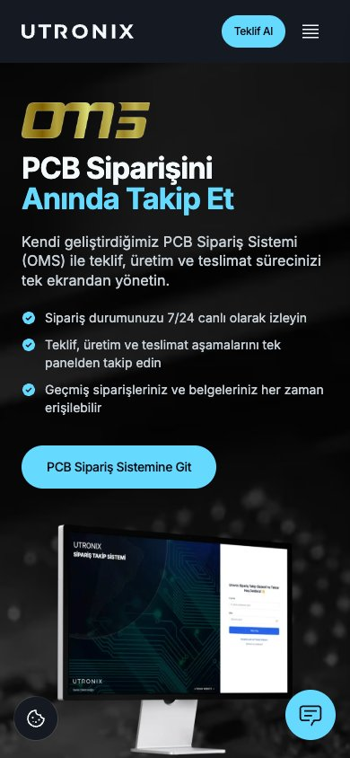

# Utronix: B2B corporate website for a PCB manufacturing company

**Live:** [u-tronix.com](https://u-tronix.com) · **Stack:** Next.js 16, React 19, TypeScript, Tailwind v4, next-intl · **Period:** Sep to Oct 2026

> 🇹🇷 **Özet:** Utron A.Ş. için Wix'ten özel altyapıya taşınan, 9 dilli B2B kurumsal web sitesi: PCB üretimi, PCB dizgi (PCBA), fiyat teklifi ve sipariş girişi. İçerik yapısını, çok dil kurulumunu, SEO/GEO'yu ve sayfa tasarım kararlarını ben yürüttüm; geliştirmeyi yapay zekâ eşli programlama (AI tooling) ile yaptım. Kaynak kod ve iç sistemler gizlidir.

## Context

Utron A.Ş. sells PCB production and assembly (PCBA) with fast turnaround and an Istanbul warehouse. The company's site lived on a website builder; the goal was a faster, fully multilingual, search-friendly site that sends buyers straight to an online price quote and order system.

## My role

I defined the structure and content strategy and built the site with an AI pair-programmer.

- **Migration:** rebuilt the whole site from Wix onto a custom Next.js stack, keeping the sales message and adding automatic PCB pricing and order entry points
- **Information architecture:** service pages, capability tables for PCB production and PCBA, "how it works" process, quality, FAQ, references, blog
- **Multilingual:** 9 languages (TR, EN, DE, FR, ES, IT, RU, UZ, AR) with localized URL slugs, about 190 URLs in the sitemap
- **Conversion:** quote buttons, WhatsApp quick quote, campaign popup, links into the separate order management system (not shown here)
- **SEO and GEO, accessibility and UI/UX patterns** documented as reusable notes for the next site
- 312 commits in 9 days (24 Sep to 2 Oct 2026)

## What is on the site

Home with a hero slider and process explainer · services (PCBA, PCB production, turnkey delivery, PCB design support) · capability tables (layers, board size, trace and space, drill, finish, component size, BGA pitch) · automatic PCB pricing page · online order entry · quality and certifications · FAQ · references · blog · light and dark theme · granular cookie consent

## Screens

| | |
|---|---|
|  **Automatic PCB pricing page** |  **PCB order entry page** |
|  **Services** |  **About** |
|  **German version** |  **Mobile** |

Click any image for the full-page capture. The order management system, customer data and admin tools are not shown.

## Skills demonstrated

Platform migration planning · information architecture for a B2B manufacturer · multilingual engineering (9 languages, localized slugs) · Next.js App Router, React and TypeScript · design tokens with Tailwind v4 · conversion-focused page design · SEO, GEO and accessibility · documentation of reusable patterns · AI-assisted development workflow

---

*The source code is private. Screenshots are captured from the public site; Utronix and its marks belong to their owner. © İlker Çetinkaya.*
